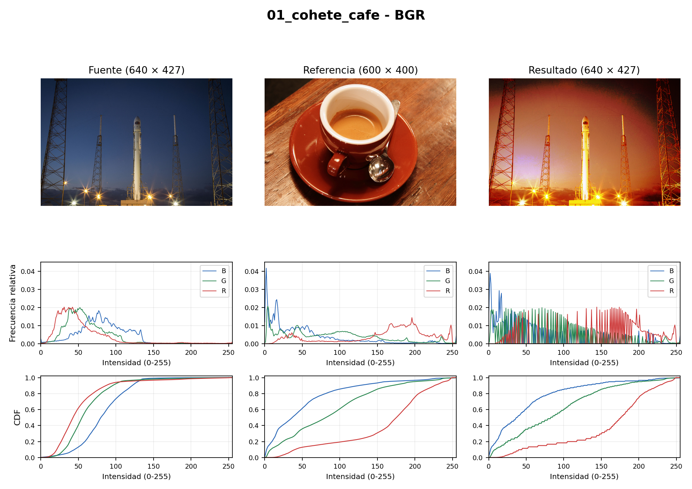
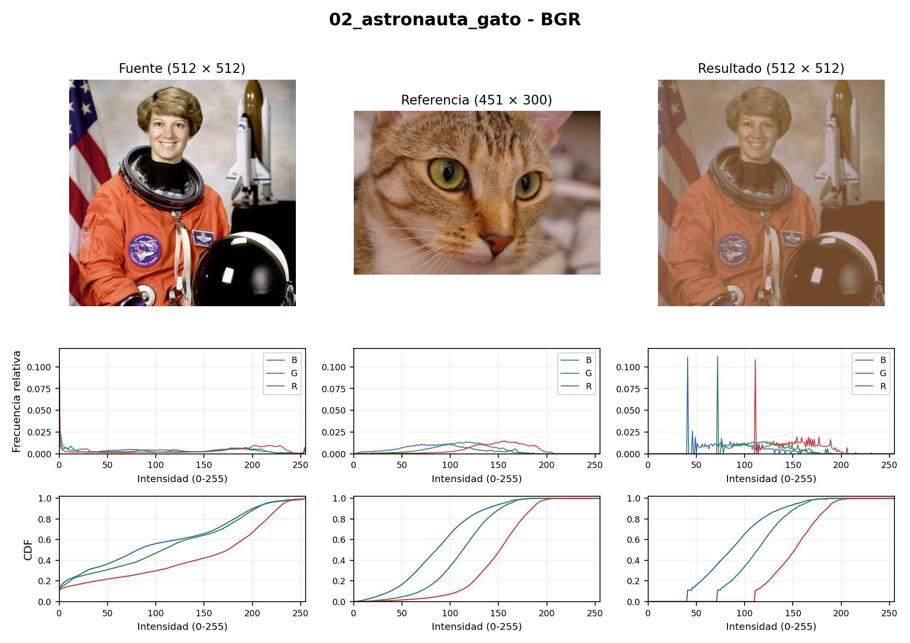
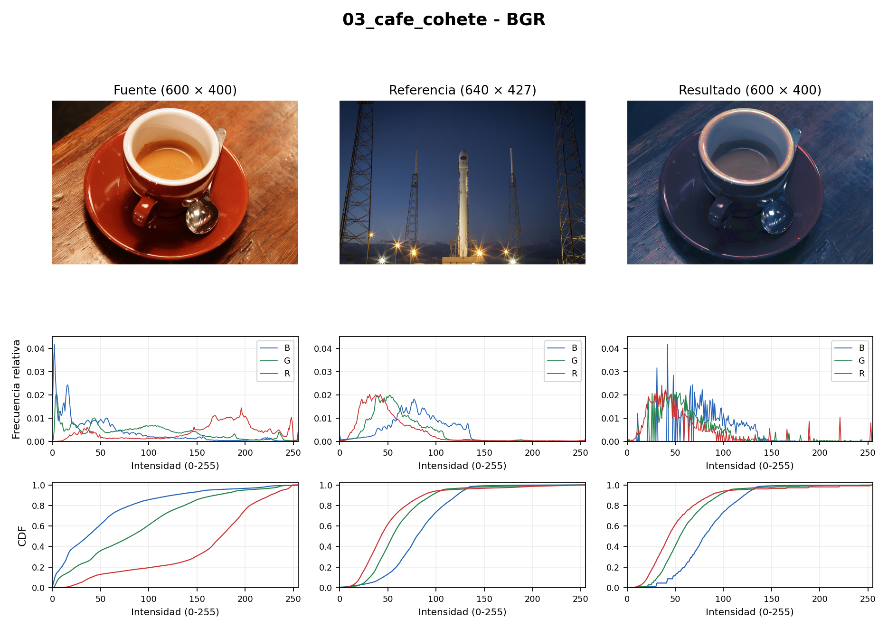
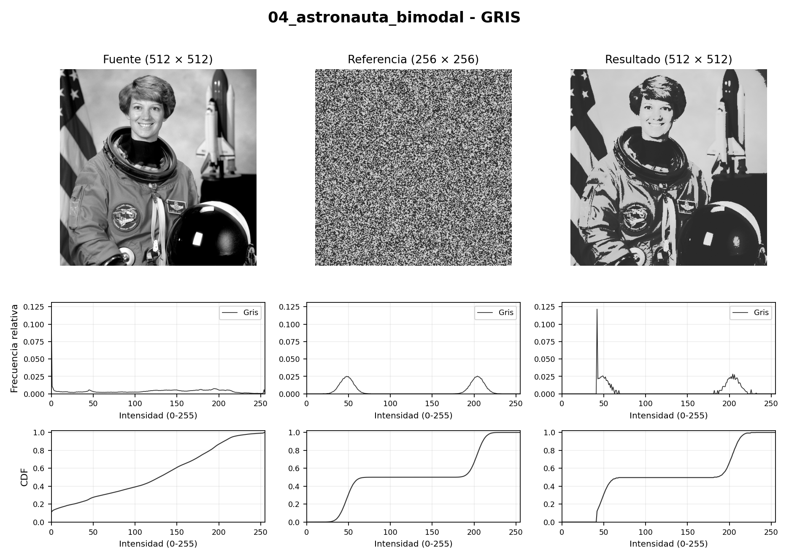

# Especificación de histograma

Tarea 4 de Visión por Computadora, Universidad de Guanajuato.

Implementación en Python para aproximar el histograma de una imagen fuente al de una referencia. Se comparan escala de grises y procesamiento por separado de los canales BGR.

## Reporte y resultados

El [reporte PDF en formato IEEE](reporte/T4_Especificacion_Histograma.pdf), con texto en dos columnas y ocho figuras, incluye el procedimiento, los cuatro experimentos, las respuestas de la actividad y la bibliografía IEEE.

Las siguientes figuras muestran fuente, referencia y resultado, con sus histogramas y CDF. No es necesario ejecutar el programa para consultarlas.

### Cohete con referencia de café



### Astronauta con referencia de gato



### Café con referencia de cohete



### Referencia bimodal



Las ocho comparaciones completas, en BGR y gris, están en [resultados](resultados/). Las distancias antes y después están en [metricas.csv](resultados/metricas.csv).

## Ejecución

Requiere Python 3.12. Desde esta carpeta:

```bash
python -m venv .venv
```

Activa el entorno en Linux:

```bash
source .venv/bin/activate
```

O en Windows PowerShell:

```powershell
.\.venv\Scripts\Activate.ps1
```

Después:

```bash
python -m pip install -r requirements.txt
python -m unittest discover -s tests -v
python main.py
python generar_reporte.py
```

Para usar otro par de imágenes de 8 bits y tres canales, sin transparencia:

```bash
python main.py --fuente foto.png --referencia referencia.jpg --salida resultados/personalizado
```

Este comando crea comparaciones y métricas del par personalizado. El PDF se genera con los cuatro casos de `experimentos.json`; para incluir otros casos en el reporte también deben actualizarse la configuración y su análisis.

## Método

Se calculan el histograma y la CDF con NumPy. Cada intensidad se sustituye por el primer nivel de referencia cuya CDF alcanza la probabilidad de la fuente. No se utilizan funciones de emparejamiento de bibliotecas.

La referencia puede tener un tamaño diferente. El resultado conserva el tamaño de la fuente. El emparejamiento es aproximado: una tabla no puede repartir los píxeles que originalmente tenían el mismo valor entre varios niveles de salida.

## Archivos

- `src/histograma.py`: histograma, CDF, tabla de correspondencias y especificación.
- `main.py`: ejecución en BGR y gris, figuras y métricas.
- `tests/`: diez pruebas con arreglos pequeños y casos conocidos.
- `datos/`: fotografías, referencia bimodal, procedencia y hashes.
- `resultados/`: imágenes, comparaciones e indicadores.
- `reporte/T4_Especificacion_Histograma.pdf`: reporte con las respuestas de la actividad.

Se prueban tres pares de fotografías y una referencia bimodal sintética. W1 y KS comparan las distribuciones antes y después; no miden que una imagen sea más natural ni que conserve su significado. En BGR se aproximan distribuciones marginales, por lo que pueden aparecer colores artificiales.

Las únicas dependencias directas son NumPy, OpenCV y Matplotlib. `opencv-python-headless` proporciona `cv2` sin ventanas gráficas. Las imágenes de ejemplo proceden de scikit-image, pero esa biblioteca no se instala ni se importa. La atribución está en [datos/fuentes.csv](datos/fuentes.csv).
